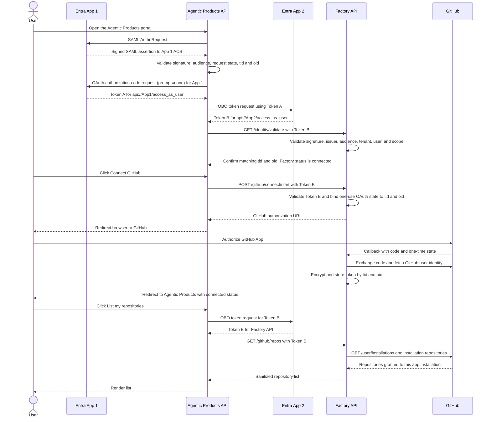

# Architecture

## Names and responsibilities

| Component | Local module | Entra role | GitHub role |
| --- | --- | --- | --- |
| Agentic Products | `agentic_products.py` on port 8001 | SAML service provider and confidential OAuth client. It obtains Token A for its own API, then performs OBO to get Token B for Factory and calls Factory's protected HTTP API. It also supports public-client device code for the terminal demo. | Its UI starts GitHub linking through Factory's API and displays the repository results. |
| Factory | `factory.py` on port 8002 | Protected API resource for the member flow. Its app registration exposes the OBO scope and validates Token B's issuer, audience, tenant, user, and `access_as_user` scope. It also has separate optional local SAML and OAuth sign-in endpoints for configuration demos. | Owns GitHub's callback, stores the linked credential encrypted against Entra `(tid, oid)`, refreshes it when needed, and lists repositories through its API. |
| Local Agentic Products SAML POC | Separate Entra **Enterprise application** for `agentic_products.py` | SAML service provider trust for the local browser app, using local Entity ID and ACS values. | Establishes the Agentic Products browser session. |
| Local Factory SAML POC | Separate Entra **Enterprise application** for `factory.py` | Optional SAML service provider trust for the local Python service, using local Entity ID and ACS values. | Independent of the member OBO and GitHub connection flow. |
| Factory hosted product SAML | Separate Entra **Enterprise application** configured from Factory's setup guide | SAML service provider trust for the hosted Factory product; uses the Entity ID, ACS URL, and metadata values shown by that Factory connection. | Signs a user into the hosted product; separate from the local SAML demo and OBO API registration. |
| Microsoft Entra ID | Cloud identity provider | Issues Token A for `agentic_products`; performs the OBO exchange and issues Token B for `factory`. MFA follows the tenant/account policy. | — |
| GitHub App | Created in the user's personal account | — | User authorizes the app. Its user token resolves this app's installation and lists only that installation's selected repositories. |

## Interactive request sequence

The two Python services have separate processes, sessions, and responsibilities. Agentic Products calls Factory's protected API over HTTP and sends Token B as a bearer token. Factory validates Token B automatically during the initial status request; its own SAML and OAuth browser endpoints are optional, independent demonstrations and are not prerequisites for the member GitHub flow. The local Factory SAML Enterprise application remains available for testing its separate ACS. OBO itself has no redirect callback.

Token A and Token B are distinct access tokens for distinct audiences. App 1 must use Token A as the OBO assertion; it cannot use an ID token or a token issued for another API. The OBO exchange preserves the user identity and changes the token audience. [Microsoft OBO protocol](https://learn.microsoft.com/en-us/entra/identity-platform/v2-oauth2-on-behalf-of-flow)

## GitHub visibility and the production diagram

This POC uses a GitHub App **user access token** to resolve the connected user's installations for this app and list repositories through `GET /user/installations/{installation_id}/repositories`. This endpoint returns repositories granted to that specific installation and visible to the user, so it honors the installation's selected-repository setting. `GET /user/repos` can be broader than the app installation selection, so Factory does not use it for the listing. [GitHub installation repository endpoint](https://docs.github.com/en/rest/apps/installations#list-repositories-accessible-to-the-user-access-token), [GitHub installations endpoint](https://docs.github.com/en/rest/apps/installations#list-app-installations-accessible-to-the-user-access-token)

The app must be installed and authorized in each account whose repositories it should access. Installing it on your personal account covers that account; repositories owned by an organization require that organization to approve/install the app. [GitHub App user-token access limits](https://docs.github.com/en/apps/creating-github-apps/authenticating-with-a-github-app/authenticating-with-a-github-app-on-behalf-of-a-user)

The production diagram also shows `ghs_` installation tokens minted per repository and renewed about every 55 minutes. Those are a separate app-authentication pattern: App 2 signs a GitHub App JWT with the app private key and mints short-lived installation tokens, scoped to an installation and optionally a repository. This POC tests the user link and installation-restricted repository discovery path with a `ghu_` user token; it does not yet reproduce the enterprise membership/SCIM checks or `ghs_` renewal relay.

## Local trust boundaries

- `agentic_products` keeps its access token in server memory. The browser receives only a random HttpOnly session cookie; this in-memory session is lost on restart.
- `factory` accepts only Entra bearer tokens issued by the configured tenant for the App 2 audience and delegated scope.
- `factory` stores GitHub access and refresh tokens in SQLite encrypted with a Fernet key kept in `.env`.
- Local SAML request state and demo identity sessions are held in memory and disappear when their service restarts; this is for localhost demonstration only.
- GitHub OAuth state is random, one-use, ten-minute state held in App 2 memory and bound to the Entra `(tid, oid)` that initiated linking.
- Both apps bind to localhost in the documented run commands. Do not expose these HTTP endpoints to a network or reuse their session/database design for production.
# Identity validation in the demo

The member path signs the user into Agentic Products with SAML, then obtains Token A through OAuth so it can call OBO. The SAML assertion itself is not Token A. Factory's API accepts Token B. Factory's local SAML browser sign-in and the hosted Factory product's WorkOS SAML connection are separate demonstrations; neither is needed for the member OBO API call. Their SAML ACS URLs are separate from the Factory OBO API registration.

## Interactive diagram

The portal renders the same five participants as lifelines: Entra App 1, Agentic Products API, Entra App 2, Factory API, and GitHub. Each numbered arrow is one request/response exchange. Selecting it shows a human-readable description, a response summary, and a redacted cURL or protocol example. Green arrows have completed; grey arrows are pending. The diagram groups SAML/OBO validation, GitHub linking, and repository listing.
